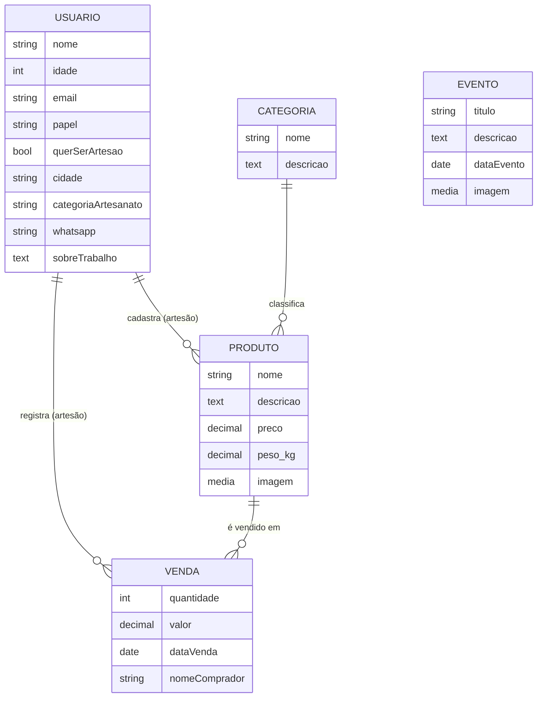

# 🏁 Loja Virtual para Artesãos Locais — Artesanato do Maciço

Plataforma web simplificada onde artesãos locais divulgam seus produtos e controlam suas vendas, conectando-os à comunidade. Projeto final da disciplina de Desenvolvimento de Software para Web, com extensão.

## 🧑‍💻 Membros da equipe

| Matrícula | Nome | Curso |
| 535636 | Lucas Cavalcante Maciel | Ciência da Computação |

## 💡 Objetivo geral

Criar uma vitrine digital para os artesãos exibirem seus trabalhos e terem um controle simples de suas vendas. O site **não processa pagamentos**: a venda é combinada diretamente entre artesão e comprador, e o sistema serve para dar visibilidade aos produtos e registrar as saídas.

## 👀 Público-alvo e cliente

- **Cliente:**  Secretaria do Trabalho e Desenvolvimento Social e em parceria com o SEBRAE.
- **Participantes da concepção:** artesãos de Capistrano e de outros municípios do Maciço de Baturité.

## 🌟 Impacto esperado

Promover a cultura e o artesanato local, dando mais visibilidade digital aos pequenos produtores para aumentar a renda dos artesãos.

===================================

## 🛠️ Tecnologias

| Camada | Tecnologia |

| Front-end | HTML, CSS e **TypeScript**, [Bootstrap 5](https://getbootstrap.com/) e Bootstrap Icons, empacotados com [Vite](https://vite.dev/) |
| Back-end | [Strapi 5](https://strapi.io/) (API REST) em TypeScript |
| Autenticação | **JWT** emitido pelo Strapi |
| Banco de dados | SQLite  |

=================================

## ▶️ Como executar

### Pré-requisitos

- [Node.js](https://nodejs.org/) **20.19 ou superior** (ou 22.12+). Recomendado: versão LTS atual.
- npm (vem com o Node).

### 1. Back-end (Strapi) — porta 1337

```bash
cd backend
cp .env.example .env        # no Windows (PowerShell): Copy-Item .env.example .env
npm install
npm run develop
```

- A API fica em `http://localhost:1337/api`.
- O painel administrativo do Strapi fica em `http://localhost:1337/admin`.
- Ao iniciar, o Strapi **cria sozinho** os papéis (Comprador, Artesao e Secretaria), as permissões de cada um e as categorias iniciais (Cerâmica, Renda e bordado, Palha, Alimentos e Tecidos).
- O banco `backend/.tmp/data.db` e as imagens em `backend/public/uploads` acompanham o repositório, com contas e dados de exemplo.

### 2. Front-end — porta 5173

Em outro terminal:

```bash
cd frontend
npm install
npm run dev
```

Abra `http://localhost:5173`.

> O front acessa o Strapi em `http://localhost:1337`.

## 🔑 Contas de teste
| Papel | E-mail | Senha |

| Secretaria (administrador do site) | `secretaria@teste.com` | `<senha_teste_secretaria>` |
| Artesão | `artesao@teste.com` | `<senha_teste_artesao>` |
| Comprador | `comprador@teste.com` | `<senha_teste_comprador>` |
| Administrador do painel Strapi (`/admin`) | `<E-MAIL-ADMIN>` | `<senha_teste_admin>` |

> **A conta da Secretaria não pode ser criada pelo cadastro**. Ela é criada no painel do Strapi: trocando o campo **Role** para `Secretaria`.

=====================================

## 👥 Papéis de usuário

| Papel | Quem é | O que pode fazer |

| **Visitante** (sem login) | Qualquer pessoa | Ver feed de produtos na home, criar conta e entrar. Qualquer outro clique leva ao login |
| **Comprador** | Conta padrão do cadastro | Home completa (filtro por categoria, busca, detalhes do produto), Eventos (somente leitura) e Perfil |
| **Artesão** | Comprador aprovado pela Secretaria | Tudo do Comprador + painel **Obras**: gerenciar os próprios produtos e registrar vendas |
| **Secretaria** | Administradora do site | Tudo do Comprador + criar, editar e excluir **Eventos/notícias** + tela **Artesãos** (analisar pedidos e aprovar/remover artesãos) |

### Como alguém vira artesão

1. No cadastro, a pessoa marca o campo **"Quero vender meus produtos como artesão"** e preenche algumas informações extras sobre o trabalho.
2. Ela entra como **Comprador** e seu pedido fica "pendente".
3. A Secretaria abre **Artesãos**, vê o perfil e escolhe **Aceitar como artesão** ou **Recusar pedido**.
4. Após a aprovação, o item **Obras** aparece no menu dela.

===================================================

## 🗃️ Entidades (tabelas)



- **Usuário:** estende o usuário do Strapi (autenticação e papéis).
- **Produto** depende de **Categoria** e do **Usuário** (artesão dono).
- **Venda** depende de **Produto** e do **Usuário** (artesão).
- **Evento** é gerenciado pela Secretaria (notícias e eventos).

### Interações de criar, editar e remover

Produtos (criar, editar, excluir), 
Eventos (criar, editar, excluir), 
Vendas (registrar, excluir), 
Secretaria (aceitar, recusar, remover permissão), 
Perfil (editar dados),
Cadastro (criar conta).

### 📁 Estrutura do repositório

```
.
├── backend/                     # Strapi
│   ├── config/                  # plugins (JWT 1h, campos extras no cadastro), CORS...
│   ├── src/
│   │   ├── api/                 # produto, categoria, evento, venda (schema, rotas, controllers)
│   │   ├── bootstrap/papeis.ts  # cria papéis, permissões e categorias iniciais
│   │   ├── extensions/users-permissions/   # campos extras do usuário, /users/me
│   │   └── utils/               # funções de apoio dos controllers
│   ├── public/uploads/          # imagens enviadas
│   └── .tmp/data.db             # banco SQLite
|
└── frontend/                    # Site
    ├── *.html                   # uma página por tela
    └── src/
        ├── scripts/             # api/, auth/, components/, utils/ e um .ts por página
        └── styles/main.css
```
